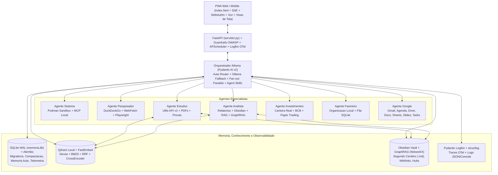

# Athena — Ecossistema Multi-Agente Local

[](#qualidade-testes-e-cicd)
[](https://www.python.org/)
[](https://ai.pydantic.dev/)
[](https://fastapi.tiangolo.com/)

**Athena** é um ecossistema pessoal multi-agente **local-first**, construído com **Pydantic AI v2**, **FastAPI**, **Qdrant (RAG Híbrido)**, **NetworkX (GraphRAG)**, **FastMCP** e **OpenTelemetry / Pydantic Logfire**. Ele orquestra 7 agentes especialistas (incluindo execução paralela *fan-out/map-reduce*), Agent Skills sob demanda, guardrails OWASP, compactação inteligente de contexto, voz neural opcional, visão de tela sob consentimento e fallback automático offline via **Ollama**.

---

## Arquitetura



---

## Principais Recursos e Diferenciais Técnicos

- **Roteamento Inteligente de Modelos + Fallback Offline com Ollama**:
  - Modo `Auto` seleciona automaticamente `gemini-3.5-flash-lite`, `gemini-3.8-flash`, `gemini-4-hydrogen` ou `gemini-4-neon` em `< 1 ms` com base na complexidade da tarefa e anexos.
  - **Circuit Breaker (`MODEL_COOLDOWN`)** combinado com **`RetryOnModelErrors`** (backoff curto `2s / 4s / 6s` por requisição HTTP) evita derrubar turnos com ferramentas durante picos transitórios de `ModelUnavailableError (503)` e alterna automaticamente para o próximo modelo disponível.
  - **Fallback Offline via Ollama (`OLLAMA_BASE_URL` / `OLLAMA_MODEL`)**: detector leve com cache de 60s (`verificar_ollama_disponivel`) habilita modelos locais como último nível de fallback no modo `Auto` e como opção manual 100% privada na interface — degradando silenciosamente quando o Ollama está desligado ou ausente.
- **Execução Paralela de Subagentes (Fan-out / Map-Reduce)**:
  - A ferramenta `consultar_especialistas_em_paralelo` executa múltiplos especialistas concorrentemente via `asyncio.gather(..., return_exceptions=True)` com `asyncio.Semaphore(4)` e timeout individual de 45s por agente, isolando falhas, emitindo progresso ao vivo no SSE e consolidando os retornos em Markdown.
- **RAG Híbrido Local + GraphRAG sobre o Obsidian Vault**:
  - **RAG Híbrido (`rag_qdrant.py`)**: indexação incremental em disco (`QdrantClient` + `FastEmbed`) dos PDFs da faculdade e notas do Obsidian combinando embeddings densos multilíngues (`paraphrase-multilingual-MiniLM-L12-v2`) com vetores esparsos (`Qdrant/bm25`) via `FusionQuery(Fusion.RRF)` e reranking local (`TextCrossEncoder`).
  - **GraphRAG leve (`grafo_obsidian.py` com `networkx`)**: constrói um `DiGraph` a partir de `[[wikilinks]]` (`[[Nota]]`, `[[Nota|Alias]]`, `[[Pasta/Nota]]`) e `#tags`, realiza travessia multi-hop (`explorar_grafo_obsidian`) para descobrir conexões indiretas entre notas e expõe métricas estruturais (top hubs e notas órfãs) em `GET /api/obsidian/grafo`.
- **Compactação Inteligente de Contexto + Extração Automática de Memória**:
  - Em conversas longas, `compactador.py` resume automaticamente mensagens antigas na tabela `resumos_conversa` (migration Alembic `002`), mantendo intactas as interações mais recentes e reduzindo o consumo de tokens.
  - Em 2º plano (`asyncio.create_task`), extrai preferências, fatos e decisões duráveis para `memoria_longo_prazo` sem atrasar o tempo de resposta do chat.
- **Agent Skills Nativas (*Progressive Disclosure*)**:
  - `skills_manager.py` escaneia `skills/*/SKILL.md`, injeta apenas um catálogo ultra enxuto no prompt da Orquestradora e carrega instruções detalhadas sob demanda via `carregar_skill` (com proteção contra *path traversal*).
- **Guardrails de Segurança (OWASP LLM Top 10) & Human-in-the-Loop**:
  - **Mascaramento de Segredos e PII (`guardrails.py`)**: detecta e redige automaticamente chaves/tokens (`AIza...`, `sk-...`, `pylf_...`, `ghp_...`, `Bearer`, senhas), CPF e cartões antes de persistir em memória/logs ou enviar ao usuário.
  - **Defesa contra Indirect Prompt Injection**: sanitiza conteúdos vindos de fontes externas não confiáveis (Web, Gmail, Ulife, Logfire), detectando padrões de injeção em PT/EN e encapsulando o conteúdo em `<conteudo_externo_nao_confiavel>`.
  - **Visão de Tela sob Demanda (`mss` + `Pillow`)**: captura redimensionada (`<= 1440px` JPEG) apenas mediante consentimento explícito do usuário a cada solicitação (card inline sem opção *"Sempre permitir"*).
  - **Controle de Acesso e Isolamento**: autenticação opcional por **PIN + Biometria WebAuthn/Passkeys** (cookie `HttpOnly` HMAC-SHA256), faxina local sem exclusão permanente (`send2trash`), ações Windows com aprovação explícita e comandos Linux isolados em container Podman (`sandbox-agentes`).
- **Voz Neural Local + Interface PWA Mobile/Desktop**:
  - Suporte opcional a **STT local (`faster-whisper`)** e **TTS neural `pt-BR` (`edge-tts`)** em `voz.py` (extras `voice`), com fallback transparente para `SpeechRecognition` / `speechSynthesis` no navegador.
  - Streaming SSE em tempo real com trilha de agentes, anexos multimodais (fotos/PDFs) e rotinas agendadas via `APScheduler`.
- **Observabilidade Completa (OpenTelemetry + Logfire + structlog) & Alembic**:
  - Instrumentação unificada (`observabilidade.py`) para Pydantic AI, FastAPI, FastMCP e HTTPX com *scrubbing* de segredos, logs estruturados `structlog` correlacionados a `trace_id`/`span_id` (`ATHENA_LOG_FORMAT=console|json`) e autodiagnóstico somente leitura via `LogfireQueryClient`.
  - Migrations versionadas e idempotentes do `memoria.db` com **Alembic** (`alembic/`), preservando 100% dos dados históricos.

---

## Otimização de Performance e Economia de Tokens

A Athena aplica uma pilha de 6 camadas complementares para minimizar latência (TTFT) e custo de API sem sacrificar qualidade:

1. **Fast-Path Determinístico Zero-LLM (`fast_path.py`)**: intercepta comandos curtos e inequívocos (abrir apps/URLs no Windows, consultar cache do Ulife, status de CPU/RAM/disco, listar skills e métricas do Obsidian) em `< 50 ms` e **0 tokens de API**, com fallback 100% transparente para a LLM em mensagens compostas ou abertas.
2. **Cache Semântico Local (`semantic_cache.py`)**: reutiliza de forma *lazy* o `FastEmbed` (`paraphrase-multilingual-MiniLM-L12-v2`) em RAM com similaridade cosseno `>= 0.94` e TTL configurável (`ATHENA_SEMANTIC_CACHE_TTL`, padrão 15 min) para responder perguntas conceituais equivalentes em **0 tokens**, bloqueando automaticamente comandos com efeito colateral e consultas de tempo real (`GET /api/cache/semantico/stats`, `POST /api/cache/semantico/limpar`).
3. **Flat Tool Architecture (`agentes.py`)**: expõe ferramentas operacionais diretas (`buscar_pdfs_faculdade_direto`, `consultar_resumo_ulife_direto`, `listar_agenda_direto`, `listar_emails_direto`, `buscar_obsidian_direto`) na Orquestradora para consultas objetivas em **1 única ida à API**, reservando subagentes `delegar_para_*` para tarefas multi-etapa complexas.
4. **Filtragem Dinâmica de Tools, Prompt Cache & Orçamento de Saída (`eficiencia.py`)**: usa `PrepareTools` para enviar **0 tools** em saudações triviais e apenas os domínios relevantes (em ordem alfabética) nos demais turnos; mantém o prefixo do system prompt 100% estático (data arredondada apenas por dia `YYYY-MM-DD`, sem `HH:MM:SS`, no final do contexto, com telemetria de `cache_read_tokens` no `structlog`) e impõe teto via `compactar_saida_tool`.
5. **Streaming Real Token-a-Token + TTFT + Reattach por Snapshot (`servidor.py` + `index.html`)**: itera `orquestrador.run_stream_events(...)` (`PartStartEvent`/`PartDeltaEvent`/`AgentRunResultEvent`) sem quebrar chamadas de ferramentas, mede `ttft_ms`, emite `reset_stream` limpo em fallback do modo Auto, envia um único `snapshot` consolidado no reattach (F5) e renderiza Markdown com throttle via `requestAnimationFrame`.
6. **Pré-otimização Multimodal (`otimizador_midia.py`)**: corrige rotação EXIF, compõe transparência sobre `#111214`, redimensiona imagens grandes para lado máximo `1280px` (`LANCZOS`) em JPEG otimizado e extrai automaticamente texto de PDFs digitais (`>= 200` chars úteis via `pypdf`) para economizar milhares de tokens visuais — preservando binário nativo para PDFs escaneados.

---

## Stack Tecnológica

| Camada | Tecnologias |
| --- | --- |
| **Agentes & IA** | Python 3.12, Pydantic AI v2, Google Gemini API, Ollama (fallback local), FastMCP |
| **Backend & Persistência** | FastAPI, Uvicorn, SSE (`StreamingResponse`), APScheduler, SQLite (WAL), Alembic, SQLAlchemy |
| **Conhecimento (RAG & Grafo)** | Qdrant Local, FastEmbed (Dense + BM25 + CrossEncoder Reranker), NetworkX (GraphRAG), PyPDF |
| **Voz & Visão (Extras Opcionais)** | `faster-whisper` (STT local), `edge-tts` (TTS neural pt-BR), `mss` + `Pillow` (visão de tela) |
| **Integrações** | Google Workspace APIs (OAuth2), Obsidian Vault, Ulife API v2, Banco Central (SGS), yfinance, Playwright |
| **Segurança, Observabilidade & CI** | Guardrails OWASP (`guardrails.py`), Pydantic Logfire, OpenTelemetry, structlog, Pytest, Pydantic Evals, Ruff, Pyright, Gitleaks |

---

## Como Executar Localmente

### Pré-requisitos
- **Python 3.12+** e **[uv](https://docs.astral.sh/uv/)**
- Chave da **Google Gemini API** (`GOOGLE_API_KEY`)
- *(Opcional)* Podman/Docker para o container `sandbox-agentes`, credenciais OAuth do Google (`credentials.json`) e conta no Pydantic Logfire.

### 1. Clonar e instalar dependências
```bash
git clone https://github.com/<seu-usuario>/ecossistema-agentes.git
cd ecossistema-agentes
uv sync --dev
```

### 2. Configurar variáveis de ambiente
Copie o modelo seguro e preencha apenas os valores desejados localmente:
```bash
cp .env.example .env
```
> **Segurança:** o `.gitignore` bloqueia `.env`, `credentials.json`, `token.json`, `ulife_cookies.json`, `memoria.db*`, `qdrant_db/` e `.logfire/`. Nunca versione chaves ou bancos locais.

### 3. *(Opcional)* Conectar Google Workspace
Salve o arquivo OAuth `credentials.json` (Desktop App do Google Cloud Console) na raiz do projeto e autentique uma única vez:
```bash
uv run --env-file .env python conectar_google.py
```

### 4. Iniciar a Athena
```bash
uv run --env-file .env uvicorn servidor:app --host 127.0.0.1 --port 8000
```
Acesse no navegador: `http://127.0.0.1:8000` (ou via `iniciar.bat` no Windows para expor na rede local/Tailscale).

---

## Qualidade, Testes e CI/CD

O repositório conta com pipeline automatizado no **GitHub Actions** ([`.github/workflows/ci.yml`](.github/workflows/ci.yml)) executado em todo `push` e `pull_request` para `main`:

1. **Secret Scan (`gitleaks`)**: varre o histórico completo do git bloqueando vazamento acidental de chaves ou tokens.
2. **Lint (`ruff`)**: verifica estilo, imports e boas práticas para Python 3.12.
3. **Typecheck (`pyright`)**: checagem estática de tipos em modo `basic`.
4. **Testes Determinísticos Offline (`pytest`)**: valida roteamento Auto, Circuit Breaker, `RetryOnModelErrors`, fallback contra 503 e Ollama local, Fast-Path Zero-LLM, Cache Semântico (embedder mockado), Flat Tool Architecture, filtragem dinâmica de tools (`PrepareTools`), higiene de Prompt Cache, streaming `run_stream_events` (`snapshot`, `reset_stream`, TTFT), pré-otimização de imagens/PDFs, fan-out paralelo de subagentes, compactação de contexto + extração de memória, Guardrails (PII/segredos e prompt injection), visão de tela com permissão, Agent Skills, voz neural, Faxineiro, permissões Windows, RAG Híbrido (Qdrant `:memory:`), GraphRAG no Obsidian (`networkx`), Alembic, `structlog`, MCP e Logfire **sem nenhuma chamada de rede ou custo de LLM**.

Execute localmente com:
```bash
uv run ruff check .
uv run pyright
uv run pytest -v
```

### Evals Agênticos (`pydantic-evals`)
Para rodar avaliações ponta a ponta contra a API real do Gemini (com registro automático no Logfire):
```bash
uv run --env-file .env python -m evals.athena_evals
```

---

## Athena Lab + Google Antigravity (CLI & MCP no VS Code)

O **Athena Lab** (`athena_lab.py`) integra-se diretamente ao ecossistema **Google Antigravity**:

- **Executor Headless via Antigravity CLI**: quando `ATHENA_LAB_USE_CLI=true` e o binário `agy` / `antigravity` (ou o caminho em `ATHENA_CODING_CLI`) é detectado via `shutil.which`, o Lab executa a implementação/auto-fix dentro de um `git worktree` isolado fora do repositório (`<temp>/athena_lab_worktrees/<id>`, evitando reloads do `uvicorn --reload`, timeout de 180s) e valida automaticamente com `ruff`, `pyright` e `pytest`.
- **Fallback Limpo (Modo Briefing VS Code)**: quando o CLI não está instalado (ou no CI Linux), a proposta aprovada pelo Crítico é salva como **"Pronta para Antigravity (VS Code)"** com um `briefing_prompt` cirúrgico copiável com 1 clique na aba **Athena Lab**.
- **Servidor MCP Local Somente Leitura (`mcp_athena_lab.py`)**: expõe `listar_propostas_lab`, `ler_ultimos_erros_logfire` e `resumo_saude_athena` para o Antigravity no VS Code inspecionar a Athena ao vivo.

Adicione o bloco abaixo em `~/.gemini/config/mcp_config.json` (ajuste o caminho do repositório se necessário):

```json
{
  "mcpServers": {
    "athena-lab": {
      "command": "uv",
      "args": [
        "run",
        "--directory",
        "C:/Users/William/Documents/ecossistema-agentes",
        "--env-file",
        ".env",
        "python",
        "mcp_athena_lab.py"
      ]
    }
  }
}
```

---

## Estrutura do Projeto

```text
ecossistema-agentes/
├── .github/workflows/ci.yml   # Pipeline CI (Gitleaks + Ruff + Pyright + Pytest)
├── .env.example               # Modelo seguro de variaveis de ambiente
├── agentes.py                 # Orquestrador Athena + Flat Tools + 7 especialistas + Auto Router + Ollama + Fan-out
├── eficiencia.py              # Filtragem dinamica de tools (PrepareTools), Prompt Cache e compactar_saida_tool
├── fast_path.py               # Roteador deterministico Zero-LLM (<50ms, 0 tokens) para comandos operacionais
├── semantic_cache.py          # Cache semantico local em RAM (FastEmbed lazy + TTL + bloqueio de acoes/tempo real)
├── otimizador_midia.py        # Pre-otimizacao de imagens (EXIF/LANCZOS/JPEG) e PDFs digitais vs escaneados
├── servidor.py                # API FastAPI, streaming run_stream_events, reattach snapshot, auth PIN/WebAuthn e paineis
├── index.html                 # Interface PWA dark-mode (chat streaming, voz, visao, carteira, estudos, faxina, rotinas)
├── rag_qdrant.py              # RAG Hibrido local (Dense + BM25 + RRF + Reranker CrossEncoder)
├── grafo_obsidian.py          # GraphRAG leve com NetworkX (wikilinks, #tags, multi-hop, hubs e notas orfas)
├── guardrails.py              # Guardrails OWASP (mascaramento PII/segredos + anti-indirect prompt injection)
├── compactador.py             # Compactacao inteligente de contexto + extracao automatica de memoria em 2o plano
├── skills_manager.py          # Loader de Agent Skills sob demanda (progressive disclosure)
├── skills/                    # Skills modulares em Markdown (SKILL.md)
├── voz.py                     # Voz neural opcional (faster-whisper STT + edge-tts TTS pt-BR)
├── logging_config.py          # Logs estruturados structlog correlacionados com trace_id/span_id OTel
├── observabilidade.py         # Configuracao OpenTelemetry + Logfire com scrubbing de dados sensiveis
├── ferramentas_logfire.py     # Consulta somente leitura ao Logfire via LogfireQueryClient (<= 3000 chars)
├── athena_lab.py              # Athena Lab R&D (Scout/Arquiteto/Critico), Logfire Sentinel e Antigravity CLI/Briefing
├── mcp_manager.py             # Gerenciador persistente de servidores MCP (FastMCP + Pydantic AI)
├── mcp_utilidades.py          # Servidor MCP local (calculadora AST segura + diagnostico do PC)
├── mcp_athena_lab.py          # Servidor MCP somente leitura do Athena Lab para o Google Antigravity (VS Code)
├── rotinas.py                 # Agendador APScheduler (sync Ulife + briefing diario no Obsidian)
├── memoria.py                 # Persistencia SQLite WAL (historico, fatos, resumos e telemetria)
├── alembic/                   # Migrations versionadas do SQLite (memoria.db)
├── ferramentas_*.py           # Modulos especializados (pc, faxina, windows, google, estudos, investimentos, obsidian, navegador)
├── tests/                     # Suite deterministica offline (pytest)
└── evals/                     # Evals agenticos automatizados (pydantic-evals)
```

---

## Licença

Projeto pessoal de portfólio e engenharia de agentes. Sinta-se à vontade para explorar a arquitetura e adaptar para seus próprios fluxos locais.
