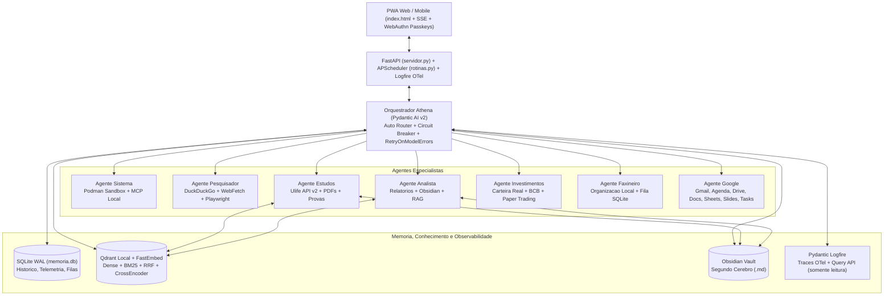

# Athena — Ecossistema Multi-Agente Local

[](#qualidade-testes-e-cicd)
[](https://www.python.org/)
[](https://ai.pydantic.dev/)
[](https://fastapi.tiangolo.com/)

**Athena** é um ecossistema pessoal multi-agente **local-first**, construído com **Pydantic AI v2**, **FastAPI**, **Qdrant (RAG Híbrido)**, **FastMCP** e **OpenTelemetry / Pydantic Logfire**. Ele orquestra 7 agentes especialistas sob uma interface web/PWA dark-mode com streaming em tempo real (SSE), execução isolada em container Linux, aprovação humana (*Human-in-the-Loop*) para ações sensíveis e roteamento resiliente de modelos Gemini.

---

## Arquitetura



---

## Principais Recursos e Diferenciais Técnicos

- **Roteamento Inteligente de Modelos + Resiliência contra 503/429**:
  - Modo `Auto` seleciona automaticamente `gemini-3.5-flash-lite`, `gemini-3.8-flash`, `gemini-4-hydrogen` ou `gemini-4-neon` em `< 1 ms` com base na complexidade da tarefa e anexos.
  - **Circuit Breaker (`MODEL_COOLDOWN`)** combinado com **`RetryOnModelErrors`** (backoff curto `2s / 4s / 6s` por requisição HTTP) evita derrubar turnos com ferramentas durante picos transitórios de `ModelUnavailableError (503)` e alterna automaticamente para o próximo modelo disponível.
  - Classificação estrita de erros: falhas de ferramentas, MCP, autenticação ou schema nunca são mascaradas como 503 do LLM.
- **RAG Híbrido Local (Denso + Esparso BM25 + RRF + Reranker)**:
  - Indexação incremental em disco (`QdrantClient` + `FastEmbed`) dos PDFs da faculdade e notas do Obsidian Vault.
  - Combina embeddings densos multilíngues (`paraphrase-multilingual-MiniLM-L12-v2`) com vetores esparsos (`Qdrant/bm25`) via `FusionQuery(Fusion.RRF)` e reranking local com `TextCrossEncoder` (`Xenova/ms-marco-MiniLM-L-6-v2`).
- **Segurança & Human-in-the-Loop**:
  - Autenticação opcional por **PIN + Biometria WebAuthn/Passkeys** com cookies `HttpOnly` assinados via HMAC-SHA256 e bloqueio contra força bruta.
  - **Faxina local e Ações Windows**: nenhuma exclusão permanente (`send2trash`) e nenhuma execução de app/URL sem aprovação explícita no card interativo (com suporte a whitelist *"Sempre permitir"*).
  - **Sandbox Linux**: comandos de terminal e escrita livre ficam isolados no container Podman (`sandbox-agentes`).
  - **Proteção contra Indirect Prompt Injection**: dados lidos de logs/traces externos são marcados explicitamente como diagnóstico passivo.
- **Observabilidade Completa com OpenTelemetry + Pydantic Logfire**:
  - Instrumentação unificada (`observabilidade.py`) para Pydantic AI, FastAPI, FastMCP e HTTPX com *scrubbing* automático de segredos (`athena_pin`, `cookie`, `authorization`, `token`, `credentials`, etc.).
  - Ferramentas enxutas de autodiagnóstico somente leitura (`buscar_erros_logfire` e `consultar_trace_logfire`) via `LogfireQueryClient`, com saída limitada a 3.000 caracteres.
- **Interface PWA Mobile + Desktop**:
  - Streaming SSE em tempo real com trilha de agentes ao vivo, upload multimodal (imagens/PDFs), entrada por voz (`SpeechRecognition`) e síntese de fala (`speechSynthesis`) em `pt-BR`.
  - Rotinas agendadas via `APScheduler` (ex.: sincronização silenciosa do Ulife e *briefing* diário salvo no Obsidian).

---

## Stack Tecnológica

| Camada | Tecnologias |
| --- | --- |
| **Agentes & IA** | Python 3.12, Pydantic AI v2, Google Gemini API, FastMCP |
| **Backend & Agendamento** | FastAPI, Uvicorn, SSE (`StreamingResponse`), APScheduler, SQLite (WAL) |
| **Busca Semântica (RAG)** | Qdrant Local, FastEmbed (Dense + BM25 + CrossEncoder Reranker), PyPDF |
| **Integrações** | Google Workspace APIs (OAuth2), Obsidian Vault, Ulife API v2, Banco Central (SGS), yfinance, Playwright |
| **Observabilidade & Qualidade** | Pydantic Logfire, OpenTelemetry, Pytest, Pydantic Evals, Ruff, Pyright, Gitleaks |

---

## Como Executar Localmente

### Pré-requisitos
- **Python 3.12+** e **[uv](https://docs.astral.sh/uv/)**
- Chave da **Google Gemini API** (`GOOGLE_API_KEY`)
- *(Opcional)* Podman/Docker para o container `sandbox-agentes`, credenciais OAuth do Google (`credentials.json`) e conta no Pydantic Logfire.

### 1. Clonar e instalar dependências
```bash
git clone https://github.com/<seu-usuario>/ecossistema-agentes.git
cd ecossistema-agentes
uv sync --dev
```

### 2. Configurar variáveis de ambiente
Copie o modelo seguro e preencha apenas os valores desejados localmente:
```bash
cp .env.example .env
```
> **Segurança:** o `.gitignore` bloqueia `.env`, `credentials.json`, `token.json`, `ulife_cookies.json`, `memoria.db*`, `qdrant_db/` e `.logfire/`. Nunca versione chaves ou bancos locais.

### 3. *(Opcional)* Conectar Google Workspace
Salve o arquivo OAuth `credentials.json` (Desktop App do Google Cloud Console) na raiz do projeto e autentique uma única vez:
```bash
uv run --env-file .env python conectar_google.py
```

### 4. Iniciar a Athena
```bash
uv run --env-file .env uvicorn servidor:app --host 127.0.0.1 --port 8000
```
Acesse no navegador: `http://127.0.0.1:8000` (ou via `iniciar.bat` no Windows para expor na rede local/Tailscale).

---

## Qualidade, Testes e CI/CD

O repositório conta com pipeline automatizado no **GitHub Actions** ([`.github/workflows/ci.yml`](.github/workflows/ci.yml)) executado em todo `push` e `pull_request` para `main`:

1. **Secret Scan (`gitleaks`)**: varre o histórico completo do git bloqueando vazamento acidental de chaves ou tokens.
2. **Lint (`ruff`)**: verifica estilo, imports e boas práticas para Python 3.12.
3. **Typecheck (`pyright`)**: checagem estática de tipos em modo `basic`.
4. **Testes Determinísticos Offline (`pytest`)**: valida roteamento Auto, Circuit Breaker, `RetryOnModelErrors`, fallback contra 503, Faxineiro, permissões Windows, RAG Híbrido (Qdrant `:memory:`), MCP e ferramentas de diagnóstico Logfire **sem nenhuma chamada de rede ou custo de LLM**.

Execute localmente com:
```bash
uv run ruff check .
uv run pyright
uv run pytest -v
```

### Evals Agênticos (`pydantic-evals`)
Para rodar avaliações ponta a ponta contra a API real do Gemini (com registro automático no Logfire):
```bash
uv run --env-file .env python evals/athena_evals.py
```

---

## Estrutura do Projeto

```text
ecossistema-agentes/
├── .github/workflows/ci.yml   # Pipeline CI (Gitleaks + Ruff + Pyright + Pytest)
├── .env.example               # Modelo seguro de variaveis de ambiente
├── agentes.py                 # Orquestrador Athena + 7 especialistas + Auto Router + RetryOnModelErrors
├── servidor.py                # API FastAPI, SSE, autenticacao PIN/WebAuthn e endpoints dos paineis
├── index.html                 # Interface PWA dark-mode (chat streaming, carteira, estudos, faxina, rotinas)
├── rag_qdrant.py              # RAG Hibrido local (Dense + BM25 + RRF + Reranker CrossEncoder)
├── observabilidade.py         # Configuracao OpenTelemetry + Logfire com scrubbing de dados sensiveis
├── ferramentas_logfire.py     # Consulta somente leitura ao Logfire via LogfireQueryClient (<= 3000 chars)
├── mcp_manager.py             # Gerenciador persistente de servidores MCP (FastMCP + Pydantic AI)
├── mcp_utilidades.py          # Servidor MCP local (calculadora AST segura + diagnostico do PC)
├── rotinas.py                 # Agendador APScheduler (sync Ulife + briefing diario no Obsidian)
├── memoria.py                 # Persistencia SQLite WAL (historico, fatos e telemetria)
├── ferramentas_*.py           # Modulos especializados (pc, faxina, windows, google, estudos, investimentos, obsidian, navegador)
├── tests/                     # Suite deterministica offline (pytest)
└── evals/                     # Evals agenticos automatizados (pydantic-evals)
```

---

## Licença

Projeto pessoal de portfólio e engenharia de agentes. Sinta-se à vontade para explorar a arquitetura e adaptar para seus próprios fluxos locais.
